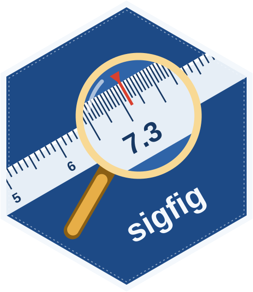

<!-- README.md is generated from README.Rmd. Please edit that file -->

```{r, include = FALSE}
knitr::opts_chunk$set(
  collapse = TRUE,
  comment = "#>",
  fig.path = "man/figures/README-",
  out.width = "100%"
)
```

# sigfig <a href="https://pkg.mitchelloharawild.com/sigfig/"></a>

<!-- badges: start -->
[](https://lifecycle.r-lib.org/articles/stages.html#experimental)
[](https://github.com/mitchelloharawild/sigfig/actions/workflows/R-CMD-check.yaml)
<!-- badges: end -->

sigfig provides numbers that know how precisely they are known. Each element of a `sigfig` vector pairs a value with the decimal places to which it is known, which is used in three ways:

- Values are displayed exactly as their precision describes.
- Arithmetic gives a result with the coarsest known precision of its inputs, so `3.2 + 4.12` is `7.3`.
- The full value is kept in calculations, so rounding error does not accumulate.

The precision is stored with run length encoding using ALTREP, so repeating the same precision across millions of numbers uses almost no extra memory, and calculations work on the runs rather than on every element.

## Installation

You can install the development version of sigfig from GitHub:

```r
# install.packages("pak")
pak::pak("mitchelloharawild/sigfig")
```

## Usage

```{r example}
library(sigfig)

x <- sigfig(3.2, p = 1)
y <- sigfig(4.12, p = 2)

# The coarsest precision is used, but the full value is kept
x + y
prec_value(x + y)
```

Precision can differ throughout a vector, and negative values count powers of ten.

```{r precisions}
sigfig(1234.567, p = c(2, 0, -2, NA))
```

Plain numbers are exact, so don't affect the precision of a result, and reductions use the coarsest precision of all of their elements.

```{r reductions}
x * 2

sum(sigfig(c(1.234, 5.6), p = c(3, 1)))
```

The precision is stored in runs, which are shown by `prec_runs()`.

```{r runs}
prec_runs(sigfig(rep(1.5, 1e6), p = 1))
```

See `vignette("sigfig")` for the details of display, comparison, and how the precision is stored.

## Caveats

- Multiplication and division also use the coarsest precision, which is a placeholder for a rule that accounts for relative error.
- `sigfig` vectors are records, so don't have names or dimensions, and some base functions such as `table()` and `summary()` don't treat them as numbers.
