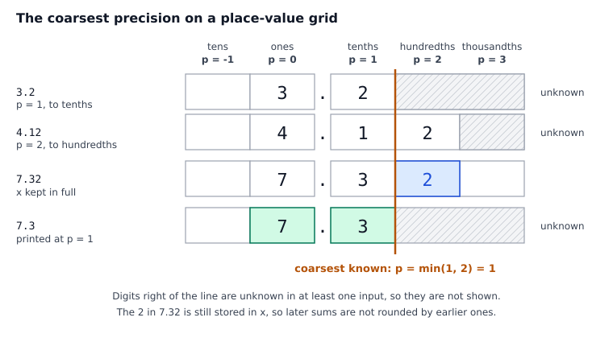
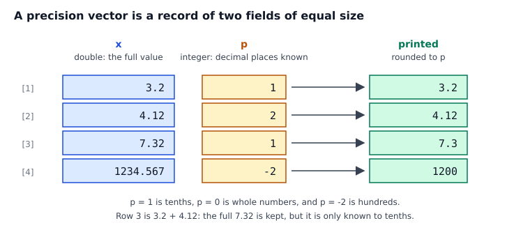
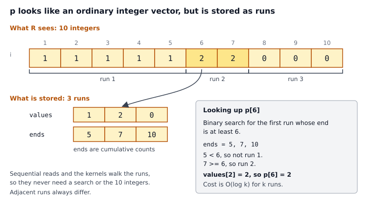
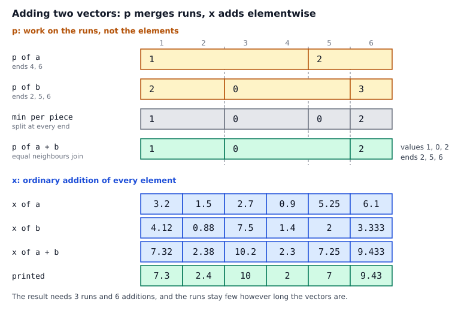
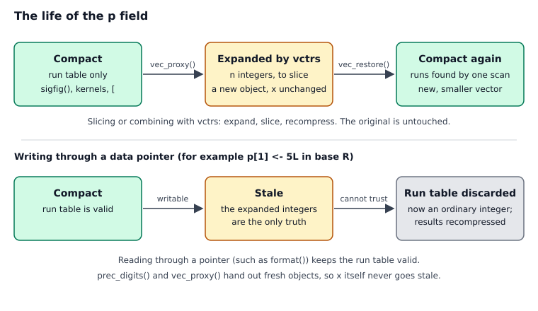

```{r, include = FALSE}
knitr::opts_chunk$set(
  collapse = TRUE,
  comment = "#>"
)
```

```{r setup}
library(sigfig)
```

## The problem

A number alone doesn't say how well it is known. Is `3.2` known to the nearest tenth, or is it `3.20` with the zero dropped? Does `1200` mean "about twelve hundred", or exactly twelve hundred? Base R forgets this the moment a number is created, so the result of `3.2 + 4.12` is `7.32`, as though both inputs were known to the hundredth.

The precision package keeps track. A `sigfig` vector pairs every number with the decimal places to which it is known:

* values are displayed exactly as their precision describes,
* arithmetic gives a result with the coarsest precision of its inputs, and
* the full value is kept, so rounding error doesn't accumulate.

The precision is stored with run length encoding, so a million numbers with the same precision cost almost nothing extra.

## Constructing

`sigfig()` takes the values and the decimal places `p`. A negative `p` counts powers of ten, so `p = -2` is known to the nearest hundred. `p` is recycled, and the default `NA` means the precision is not known, or the number is exact.

```{r construct}
sigfig(c(3.2, 4.12), p = c(1, 2))

sigfig(1234.567, p = c(2, 0, -2, NA))
```

`as_sigfig()` also reads the precision from text, counting the decimal places written, less any exponent.

```{r as-precision}
as_sigfig(c("3.20", "4.1", "1.20e3"))
```

Plain numbers become exact (`p = NA`), and the precision of an existing vector can be replaced with `set_digits()`.

## Display

The display rule is to round to `p` and show exactly that many decimal places.

* **Positive `p`** shows `p` decimal places, including trailing zeros: `sigfig(3.2, 2)` is `3.20`.
* **Zero or negative `p`** shows a whole number. With negative `p` the unknown digits are zeros, so `1234.567` known to the nearest hundred is `1200`.
* **Missing `p`** shows an ordinary R number, with up to 15 significant digits.
* A missing value (`x = NA`) is `NA`, whatever its `p`.

```{r display}
x <- sigfig(c(3.2, 9.996, -0.04, 1234.567, NA, 2.5), c(2, 2, 1, -2, 1, NA))
x
format(x)
```

Note that `-0.04` shown to a tenth is `0.0`, never `-0.0`. Printing never changes the stored value, which `prec_value()` (or `as.double()`) returns in full.

```{r values}
prec_value(x)
```

## Arithmetic

The result of arithmetic has the coarsest known precision of its inputs, meaning the smallest `p`. The full value is calculated and kept, and rounded only when displayed.

```{r arith}
a <- sigfig(3.2, 1)
b <- sigfig(4.12, 2)
a + b
prec_value(a + b)
```

The sum is displayed as `7.3`, because `a` is only known to the tenth, but `x` still holds `7.32`. The figure below shows why: the hundredths digit is unknown for `a`, so it can't be known for the sum.

```{r fig-grid, echo = FALSE, out.width = "100%", fig.alt = "A place-value grid with columns from tens to thousandths. 3.2 is known to the tenths, and 4.12 to the hundredths. A vertical line after the tenths column marks the coarsest known precision, p = 1. The sum 7.32 is stored in full, but printed as 7.3."}

```

Keeping the full value matters when many steps are chained. Rounding after every step loses what is below the display precision, and the loss compounds. Ten additions of `0.04`, known to the tenth, show the difference.

```{r accumulate}
y <- sigfig(rep(0.04, 10), p = 1)

# Rounding every step: each 0.04 becomes 0.0
Reduce(`+`, round(prec_value(y), 1))

# Keeping the full value, and rounding once to display
sum(y)
Reduce(`+`, as.list(y))
```

Plain numbers are exact, so don't make the result any coarser, and `NA` precision never wins over a known precision.

```{r exact}
a * 2
a + 5
a + sigfig(5, NA)
```

### Reductions

Reductions (`sum()`, `prod()`, `mean()`, `min()`, `max()`, `range()`, `median()` and `quantile()`) use the coarsest precision of all elements. Cumulative functions use the coarsest precision of the elements so far. Missing values are ignored for the precision only when `na.rm = TRUE`.

```{r reductions}
z <- sigfig(c(1.234, 5.6, 7.89), p = c(3, 1, 2))
sum(z)
mean(z)
cumsum(z)
```

Rounding functions only ever make the precision coarser: `round(z, 2)` is known to at most 2 decimal places, and `floor()` to at most 0. Functions such as `exp()`, `sqrt()` and `abs()` keep the precision of their input.

## Comparison and grouping

Comparison rounds both sides to their common coarsest precision. Plain numbers are exact, so take the precision of the other side.

```{r compare}
sigfig(3.14159, 2) == 3.14
sigfig(3.12, 2) == sigfig(3.1, 1)
```

Equality like this is not transitive. With `3.12` and `3.14` both known to the hundredth, and `3.1` known to the tenth:

```{r transitive}
u <- sigfig(3.12, 2)
v <- sigfig(3.1, 1)
w <- sigfig(3.14, 2)
c(`u == v` = u == v, `v == w` = v == w, `u == w` = u == w)
```

If `==` were used to find duplicates, which values are grouped together would depend on the order they were seen. So `unique()`, `duplicated()`, `match()`, `sort()`, `order()` and grouping don't use it. They use each element's own rounded value *and* its precision, so `3.1` (to the tenth) and `3.10` (to the hundredth) are different values, with the coarser sorted first. All missing values are the same.

```{r grouping}
unique(sigfig(c(3.1, 3.1, 3.12), p = c(1, 2, 1)))
vctrs::vec_equal(u, v)
```

`min()`, `max()` and `range()` compare the full value.

## The data structure

A `sigfig` vector is a `vctrs::new_rcrd()` record with two fields of equal size: the full values `x`, and the precision `p`.

```{r fig-rcrd, echo = FALSE, out.width = "100%", fig.alt = "A record with two fields. Field x is a double vector holding 3.2, 4.12, 7.32 and 1234.567. Field p is an integer vector holding 1, 2, 1 and -2. Arrows lead to the printed values 3.2, 4.12, 7.3 and 1200."}

```

```{r fields}
vctrs::fields(z)
vctrs::field(z, "p")
prec_digits(z)
```

`p` looks like an ordinary integer vector, but it is stored with run length encoding using ALTREP. Each run is a precision value and the position where it ends.

```{r fig-runs, echo = FALSE, out.width = "100%", fig.alt = "A vector of ten integers, 1 1 1 1 1 2 2 0 0 0, stored as a run table with values 1, 2, 0 and cumulative ends 5, 7, 10. A panel shows how looking up element 6 binary searches the ends for the first one at least 6, finding run 2 and a value of 2."}

```

`prec_runs()` shows the runs without expanding anything.

```{r runs}
big <- sigfig(rep(1.5, 1e6), p = 1)
prec_runs(big)
length(big)
```

Everything that works on `p` is written to use the runs. Adding two vectors merges their run tables, taking the minimum of each piece, so the work depends on the number of runs and not the length of the vectors. The values in `x` are added as usual.

```{r fig-add, echo = FALSE, out.width = "100%", fig.alt = "Two vectors of six elements with precision runs. Vector a has runs 1 and 2 ending at 4 and 6. Vector b has runs 2, 0 and 3 ending at 2, 5 and 6. Splitting at every end and taking the minimum gives 1, 0, 0, 2, and joining equal neighbours gives the result runs 1, 0 and 2 ending at 2, 5 and 6. Below, the x values are added elementwise to give 7.32, 2.38, 10.2, 2.3, 7.25 and 9.433, printed as 7.3, 2.4, 10, 2, 7 and 9.43."}

```

The same example, with live code.

```{r add-example}
a6 <- sigfig(c(3.2, 1.5, 2.7, 0.9, 5.25, 6.1), p = c(1, 1, 1, 1, 2, 2))
b6 <- sigfig(c(4.12, 0.88, 7.5, 1.4, 2, 3.333), p = c(2, 2, 0, 0, 0, 3))
ab <- a6 + b6
ab
prec_runs(ab)
```

### Lifecycle

Compact `p` is kept compact where it matters. vctrs slices and combines vectors by working with integers, so it needs `p` as ordinary integers. `vec_proxy()` gives it a new object sharing the same run table, which vctrs expands as needed, and `vec_restore()` recompresses the result. Writing to `p` through a data pointer, as base R sometimes does, makes the run table stale, so it is discarded and results are recompressed instead.

```{r fig-lifecycle, echo = FALSE, out.width = "100%", fig.alt = "Two flows. First, vec_proxy passes vctrs a new object sharing the compact p, which vctrs expands and slices, and recompressed by vec_restore. Second, a writable data pointer makes a compact p stale, and the run table is then discarded, so it is treated as an ordinary integer."}

```

A slice of a compact vector is compact, and writing to a copy of `p` doesn't disturb the original. The state check below uses an internal function, only to show what happens.

```{r lifecycle}
state <- sigfig:::rle_state

state(prec_digits(big))
state(prec_digits(big[2:(1e6 - 1)]))

p <- prec_digits(big)
p[1] <- 5L
c(written = state(p), original = state(prec_digits(big)))
```

Short vectors (fewer than 64 elements), and vectors with too many runs to be worth it (more than one per four elements), are stored as ordinary integers. This is invisible apart from the memory used, so the run table is only an optimisation, and `p` can always be used as an integer.

Run length encoding is kept when saving, so the precision of a million numbers serialises to a few hundred bytes. Loading it requires the package to be installed.

```{r serialise}
length(serialize(prec_digits(big), NULL))
length(serialize(rep(1L, 1e6), NULL))
```

## Performance

The run table makes the cost of `p` small. These timings were measured once on one machine (R 4.6.2, gcc 13.3 with `-O2`, an Intel Core Ultra 7 258V, with other load running), for vectors of 10 million doubles with `bench::mark()`. They are indicative only, and aren't run when the vignette is built.

| Operation | Time |
|:--|--:|
| `a + b` for doubles | 48 ms |
| `x + y`, compact `p` (1 to 1000 runs) | 48 ms |
| `x + y`, incompressible `p` | 68 ms |
| `x + y` with `p` as ordinary integers and `pmin()` | 85 ms |
| `sum(a)` for a double | 12.5 ms |
| `sum(x)` | 12.7 ms |
| `x[2:(n - 1)]` | 86 ms |
| `a[2:(n - 1)]` for a double | 54 ms |
| `x == y` | 511 ms |
| `a == b` for doubles | 26 ms |

The time for `p` alone, when adding at this size, is 1.9 microseconds for 1 run, 6.8 microseconds for 1000 runs, and 31 milliseconds for incompressible `p`. Adding is dominated by allocating the double result, so a compact `p` costs a small constant, mostly S3 and vctrs dispatch. Comparison is slower than for doubles because both sides are rounded, at around 20 nanoseconds per element. The serialised `p` of 10 million elements is 137 bytes for 1 run, and 8 KB for 1000 runs, rather than 40 MB.

## Limitations

* **Multiplication and division use the coarsest `p` too.** This is a placeholder, and is natural for addition and subtraction where absolute errors add. For `*` and `/` it misstates relative error. `sigfig(0.01, 2) * 100` is `1.00` though only one figure is known, and small products can vanish.

    ```{r limits-mult}
    sigfig(0.01, 2) * 100
    sigfig(0.1, 1) * sigfig(0.1, 1)
    ```

    The rule is provisional. The precision of a result is decided in one place, so a rule based on significant figures (as taught in school science), or on propagating the uncertainty, could replace it. Either would depend on the values, so would split the runs of `p` wherever results change magnitude.
* **Records, not atomic vectors.** Like other vctrs records, `is.numeric()` is `FALSE`, `table()` and `tapply()` don't treat them as atomic, `summary()` isn't implemented, and there are no names or dimensions.
* **Dispatch follows the first argument.** `c(1, x)` and `sum(1, x)` use base R. Use `vctrs::vec_c(1, x)` and `sum(x, 1)`.
* **Precision doesn't always survive text.** Negative `p` is lost, since `"1200"` is read with `p = 0`.
* **Arithmetic with logical vectors is an error,** unless they are all `NA`.
